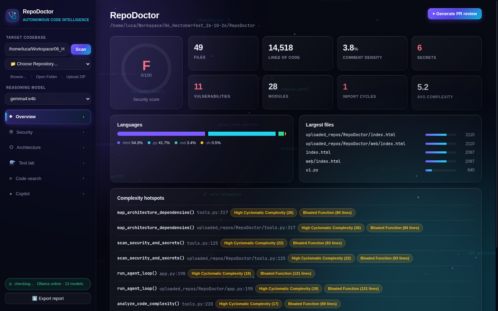
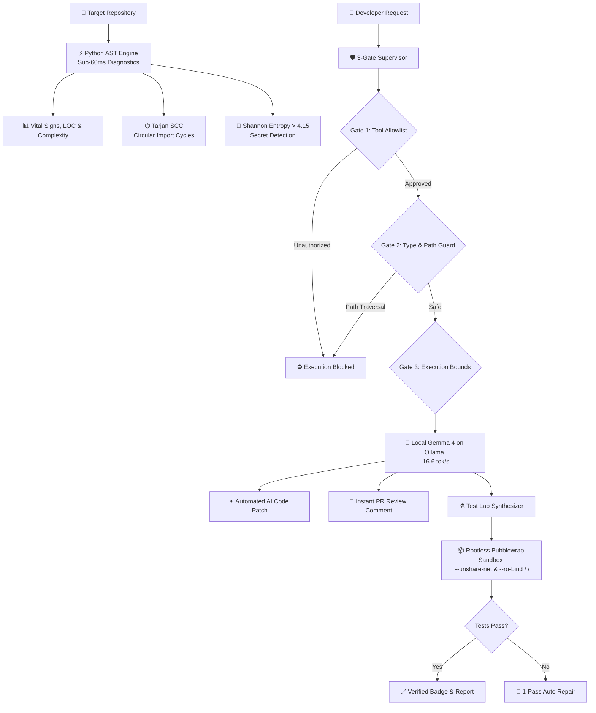

<div align="center">

# 🩺 RepoDoctor
### Autonomous Codebase Health, DevSecOps Auditing & Unit Test Synthesizer
**100% Offline · Zero Cloud Telemetry · Powered Locally by Google Gemma 4 via Ollama**

[](LICENSE)
[](https://python.org)
[](https://ollama.com)
[](https://github.com/containers/bubblewrap)
[](#-security--air-gap-guarantees)
[](https://github.com/AGIQdev-Aditya/RepoDoctor)

<br/>



<br/><br/>

[🚀 Quickstart](#-quickstart) • [🏗️ Architecture](#%EF%B8%8F-3-gate-verification-pipeline) • [🌟 Core Capabilities](#-core-capabilities) • [💻 CLI Engine](#-terminal-cli-engine) • [🛡️ Security](#%EF%B8%8F-security--air-gap-guarantees) • [👥 Team](#-team)

</div>

---

## 👥 Team
* **Aditya Sharma** — Project Lead & Architecture ([@AGIQdev-Aditya](https://github.com/AGIQdev-Aditya))
* **Abhay Singh** — Backend Hardening & DevSecOps ([@abhaysingh1230](https://github.com/abhaysingh1230))
* **Akshay More** — Test Verification & CLI Optimization ([@Akshaymore1608](https://github.com/Akshaymore1608))

---

## 💡 The Problem & The Mission
During Hacktoberfest sprints and rapid open-source prototyping, developers ship features at high velocity. In the process, they frequently commit critical defects:
1. **Accidental Credential Leaks**: Hardcoded API keys (AWS, OpenAI, GitHub, Database connection strings) committed into repositories.
2. **Circular Import Crashes**: Hidden module import loops (`module_a -> module_b -> module_a`) that crash Python interpreters at runtime.
3. **Zero Test Coverage**: Untested functions pushed to production without unit tests or regression safeguards.
4. **Cloud Privacy Leaks**: Developers want AI assistance, but **cannot upload confidential enterprise, client, or campus codebases to third-party cloud LLM APIs** without severe compliance risks.

**RepoDoctor** solves this by providing a **100% air-gapped, autonomous code intelligence engine** that audits repositories, hunts vulnerabilities, maps architecture, and synthesizes verified tests—running entirely on local hardware with zero external network packets.

---

## 🌟 Core Capabilities

| Feature | Description | Engine / Tech |
| :--- | :--- | :--- |
| **◈ Overview & Vital Signs** | Instant health grade ($A+$ to $F$), LOC metrics, comment density, and complexity hotspots. Generates autonomous GitHub PR reviews. | Python AST + Google Gemma 4 |
| **⛨ DevSecOps Scanner** | Detects leaked credentials and execution sinks (`eval`, `exec`, `shell=True`). Shannon Entropy ($>4.15$) eliminates false alarms. | AST + Shannon Entropy + Gemma 4 |
| **⌬ Architecture & Cycle Finder** | Extracts AST imports and mathematically pinpoints circular import loops with an interactive force-directed graph. | Tarjan's SCC Algorithm $O(V+E)$ |
| **⚗ Test Lab & Sandboxing** | Synthesizes full `pytest` suites and verifies them inside a rootless, network-unshared Linux container with auto-repair. | Bubblewrap (`bwrap`) + Gemma 4 |
| **⌕ Offline Semantic Search** | Natural-language code search with disk-cached local embeddings. | `nomic-embed-text` via Ollama |
| **✦ 3-Gate Supervisor Copilot** | Multi-turn reasoning agent calling diagnostic tools under strict security supervision with a live tool ledger. | Strict 3-Gate Security Loop |

---

## 🏗️ 3-Gate Verification Pipeline

RepoDoctor strictly enforces the **3-Gate Execution Protocol** to ensure that non-deterministic language models never perform unsafe operations:



---

## ⚡ Feature Comparison

| Capability | Cloud SaaS (Snyk, Copilot, Sonar) | RepoDoctor (This Project) |
| :--- | :---: | :---: |
| **100% Offline / Air-Gapped** | ❌ Uploads code to cloud | **✅ 100% Local (Runs with Wi-Fi disabled)** |
| **Zero Cloud Subscriptions** | ❌ Monthly fees per seat | **✅ 100% Free & Open-Source (Apache 2.0)** |
| **Hardware-Isolated Test Sandbox** | ❌ Simulated / Cloud runner | **✅ True Linux Bubblewrap (`bwrap`) Container** |
| **Circular Import Detection** | ⚠️ Static warnings only | **✅ Mathematical Tarjan SCC $O(V+E)$ Cycles** |
| **False-Alarm Credential Guard** | ⚠️ High false positives | **✅ Shannon Entropy Analysis ($>4.15$ bits/char)** |
| **Full Diagnostic Latency** | ⏱️ 5 – 30 seconds | **⚡ Sub-60 milliseconds** |

---

## 🚀 Quickstart

### 1. Prerequisites
* **Linux** (Arch, Ubuntu, Debian, Fedora) or **macOS**
* **Python 3.10+**
* **[Ollama](https://ollama.com/)** running locally:
  ```bash
  ollama pull gemma4:e4b
  ollama pull nomic-embed-text
  ```
* *(Optional for hardware sandboxing on Linux)*: `bubblewrap`
  ```bash
  # Arch Linux
  sudo pacman -S --needed bubblewrap
  # Ubuntu / Debian
  sudo apt-get install bubblewrap
  ```

### 2. Clone & Setup
```bash
git clone https://github.com/AGIQdev-Aditya/RepoDoctor.git
cd RepoDoctor

python3 -m venv venv
source venv/bin/activate
pip install -r requirements.txt
```

### 3. Launch
```bash
# 1-Click Launch (Starts Web Console at http://127.0.0.1:8502)
./run.sh
```

---

## 💻 Terminal CLI Engine

For terminal-first workflows, CI/CD pipelines, and pre-commit checks:

```bash
# Instant sub-100ms Vital Signs & Vulnerability Scorecard
python cli.py

# Generate Gemma 4 PR Review directly in terminal
python cli.py --pr

# Launch interactive 3-Gate Copilot session in terminal
python cli.py --chat

# Audit a specific target codebase path
python cli.py /path/to/project
```

---

## 🛡️ Security & Air-Gap Guarantees

* **DNS Rebinding Protection**: The HTTP server enforces strict Host header (`localhost`, `127.0.0.1`, `[::1]`) and Origin header checks.
* **Content Security Policy (CSP)**: `default-src 'self' 'unsafe-inline' data:; connect-src 'self'`. Zero third-party CDN scripts or remote analytics.
* **Zip-Slip & Bomb Guards**: Compressed archive uploads enforce canonical path containment within target directories and cap decompression expansion ratios ($<100\times$, $<100\text{ MB}$).
* **ReDoS Windowing**: Security regex engines evaluate input across 2,000-character overlapping sliding windows to prevent catastrophic backtracking.
* **Rootless Sandbox**: Linux `bwrap` executes test code with `--unshare-net` (no network sockets), `--ro-bind / /` (read-only filesystem), and strict POSIX resource limits (`RLIMIT_CPU`, `RLIMIT_AS`).

---

## 📄 License

Licensed under the **Apache 2.0 License**. See [LICENSE](LICENSE) for details.
Built with pride for **Hacktoberfest Hack Day Pune × NIAT–ADYPU 2026**.
